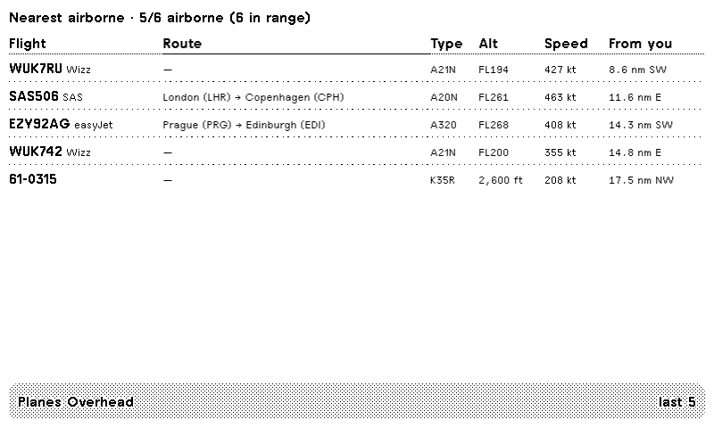
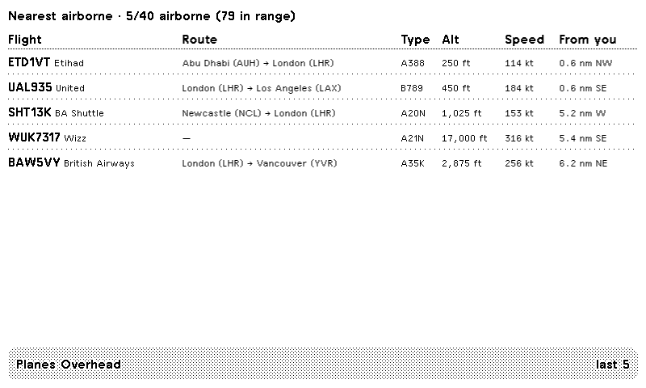

# Planes Overhead

Last five airborne aircraft near a point, with distance and compass bearing, for a TRMNL e-ink display. A Cloudflare Worker can add origin → destination routes.





Smaller mashup layouts are in `screenshots/` (`half_horizontal.png`, `half_vertical.png`, `quadrant.png`).

## Data and attribution

Nearby traffic comes from the [adsb.lol](https://api.adsb.lol) readsb-style API:

`GET https://api.adsb.lol/v2/lat/{lat}/lon/{lon}/dist/{nm}`

`dst` is distance in nautical miles and `dir` is the bearing from your centre point. That data is made available under the [Open Database License (ODbL) 1.0](https://opendatacommons.org/licenses/odbl/1-0/). Contains information from adsb.lol, which is made available under the ODbL.

Routes are best-effort and only filled in Worker mode:

1. `POST https://api.adsb.lol/api/0/routeset` with `{planes:[{callsign,lat,lng}]}` — often returns an empty 201; still tried first.
2. `GET https://api.adsb.lol/api/0/route/{callsign}` — `_airports[]` with `location` / `iata`.
3. Fallback: `GET https://api.adsbdb.com/v0/callsign/{callsign}` — origin and destination municipality plus IATA.

Display format: `Dubai (DXB) → London (STN)`.

The adsbdb fallback uses flight-route data by David Taylor (Edinburgh) and Jim Mason (Glasgow), served by [adsbdb](https://adsbdb.com/). That route data may not be copied, published, or incorporated into another database without David J. Taylor’s permission. This plugin only looks routes up live to label the screen; it does not republish the database.

Refresh at 15 minutes or slower. The Worker does one nearby fetch plus up to five route lookups per refresh.

## Modes

TRMNL polling can hit several URLs and send a static POST body, but it fetches those URLs in parallel and cannot take callsigns from the nearby response and feed them into a route lookup in the same refresh. Direct polling therefore leaves `route` blank. Point `polling_url` at the Worker when you want routes.

| Mode | `polling_url` | Routes |
|------|---------------|--------|
| Direct (default in `src/settings.yml`) | `https://api.adsb.lol/v2/lat/{{ latitude }}/lon/{{ longitude }}/dist/{{ radius_nm }}` | No |
| Worker | `https://<your-worker>/?lat={{ latitude }}&lon={{ longitude }}&nm={{ radius_nm }}` | Yes (`mode: routed`) |
| Worker + KV history | same URL with `&history=1` | Yes, rolling last-seen list (`mode: history`) |

## Install

### Import a ZIP into TRMNL

TRMNL’s private-plugin import expects a flat archive: `settings.yml` at the root, next to the Liquid files and `transform.py` (no `src/` folder inside the zip).

```sh
cd src
zip -r ../planes-overhead-trmnl.zip \
  settings.yml full.liquid half_horizontal.liquid \
  half_vertical.liquid quadrant.liquid transform.py
```

In the TRMNL dashboard open **Private Plugins → Import new** and select that zip. Then set latitude, longitude, and radius. Defaults in `src/settings.yml` are Ipswich (`52.0567`, `1.1482`) and `12` nm. For routes, change **Polling URL** to your Worker (see below) before you rely on the Route column.

### Preview and push with trmnlp

This repo is a [trmnlp](https://github.com/usetrmnl/trmnlp) project (`.trmnlp.yml` plus `src/`). With Ruby 4 or newer:

```sh
gem install trmnl_preview
trmnlp serve    # http://localhost:4567
trmnlp login
trmnlp push
```

Docker install and the rest of the commands are in the [trmnlp README](https://github.com/usetrmnl/trmnlp). `.trmnlp.yml` is local-only (it is not uploaded). Give `src/settings.yml` an `id` after the first push so later `trmnlp push` runs update that plugin instead of creating a new one.

### Deploy the Worker

From `worker/`, with [Wrangler](https://developers.cloudflare.com/workers/wrangler/install-and-update/) logged in (`npx wrangler login`):

```sh
cd worker
npx wrangler deploy
```

Wrangler prints a `*.workers.dev` URL. Set the plugin polling URL to:

```text
https://trmnl-planes-overhead.<account>.workers.dev/?lat={{ latitude }}&lon={{ longitude }}&nm={{ radius_nm }}
```

`worker/wrangler.toml` sets fallback `LAT`, `LON`, and `RADIUS_NM` when those query params are missing. The script reads `?lat=`, `?lon=`, and `?nm=`.

KV history is optional. It stores a rolling set of aircraft and returns the five most recently seen (`mode: history`). Create a namespace, then uncomment the binding already sketched in `worker/wrangler.toml` and paste the id Wrangler prints. The binding name must stay `OVERHEAD_KV` — that is what `worker/src/index.js` reads.

```sh
npx wrangler kv namespace create OVERHEAD_KV
```

```toml
[[kv_namespaces]]
binding = "OVERHEAD_KV"
id = "<NAMESPACE_ID>"
```

Redeploy, then add `&history=1` to the polling URL. Without the binding, `?history=1` is ignored and the response stays `mode: routed`.

## What the screen shows

Columns are callsign and airline, route, type, altitude, speed, and distance plus an 8-point compass bearing (`2.9 nm NE`).

- Airborne filter drops ground traffic, ground speed under 50 kt, ADS-B category `C*`, and `TWR` / `GND` vehicles.
- Missing callsign falls back to registration, then hex. It never renders a placeholder dot row.
- Altitude is `12,450 ft`, or `FLxxx` at 18,000 ft and above.
- Route coverage follows schedules and callsign databases. Light aircraft often have none.

## License

MIT. See [LICENSE](LICENSE). Copyright 2026 Alex Baldry.
